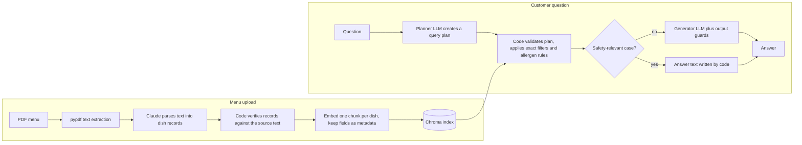

# Restaurant Menu Assistant

A retrieval-augmented chatbot that answers customer questions about a restaurant menu (dishes, prices, dietary options, allergens). The restaurant uploads a menu PDF, the system turns it into structured dish records, and customers ask questions in a chat UI.

**Live demo:** http://52.29.97.242/ (hosted temporarily on AWS EC2, the instance could be terminated in the future. Please check with the author for the latest IP address)

---

## Contents

1. [What this project shows](#what-this-project-shows)
2. [Why structured RAG instead of classic RAG](#why-structured-rag-instead-of-classic-rag)
3. [Architecture](#architecture)
4. [Safety design](#safety-design)
5. [Evaluation](#evaluation)
6. [Limitations](#limitations)
7. [Future improvements](#future-improvements)
8. [Run it locally](#run-it-locally)
9. [Docker and AWS deployment](#docker-and-aws-deployment)
10. [API](#api)
11. [Configuration](#configuration)
12. [Project structure](#project-structure)
13. [Technology choices](#technology-choices)

---

## What this project shows

- An end-to-end RAG system: PDF ingestion, structured parsing, embeddings, filtered retrieval, grounded generation, API, UI, container, cloud deployment.
- Engineering for a domain where wrong answers can hurt (allergens): code, not the LLM, controls everything safety-relevant.
- A measured evaluation: a naive baseline, development sets, **locked test sets run once**, failures analysed and reported, including the ones that were not fixed.
- Honest documentation of what was tested and what was not (see [Limitations](#limitations)).

## Why structured RAG instead of classic RAG

A classic pipeline splits a document into fixed-size chunks, embeds them and retrieves by similarity. A menu is a list of records with exact attributes (price, dietary tags, allergens), and embeddings are weak at exact constraints.

Question: *"vegan starter under 8 euros"*, similarity search only, top 3 results from the same index:

| Rank | Result | Problem |
|---|---|---|
| 1 | Espresso | A drink, not a starter |
| 2 | Bruschetta al Pomodoro (7.50, vegan) | Correct |
| 3 | Burrata e Rucola (11.00, not vegan) | Wrong on diet and price |

So this project parses the menu into dish records first, uses **one chunk per dish**, keeps the fields as metadata, and applies exact filters before similarity:

| Stage | Classic RAG | This project |
|---|---|---|
| Parse | none | PDF text to dish records (name, category, price, tags, allergens) |
| Chunk | fixed-size split | one chunk per dish |
| Retrieve | similarity | metadata filter, then similarity, then explicit rules |
| Generate | answer from chunks | answer from chunks, with code-level guards and fixed-text paths |

One honest note: a single small menu would fit in an LLM prompt, so RAG is not strictly required at this scale. The design is justified by scaling to larger menus and multiple documents, and by being able to measure retrieval separately from generation.

## Architecture



**Ingestion** (`app/loader.py`, `app/parser.py`, `app/verify.py`, `app/store.py`)

1. `pypdf` extracts text. A PDF with no selectable text (a scan) is rejected with a clear error instead of silently producing an empty index.
2. Claude fills a strict schema (tool call). It must copy names exactly, decode dietary-tag legends but not infer tags from ingredients, and set `allergens_stated=true` only when a dish explicitly lists allergens. Dish IDs are assigned by code.
3. Code verifies the output against the PDF text: dishes whose name is not in the text are dropped, prices not found in the text become "unknown", and allergen claims are reset if the menu never mentions allergens.
4. Each dish becomes one embedding (`all-MiniLM-L6-v2` via `fastembed`, ONNX, no PyTorch) stored in ChromaDB with flat metadata (category, price, one boolean per tag and per allergen) plus the full record.
5. A new upload **replaces** the old index, so an outdated dish can never be served.

**Query** (`app/query_plan.py`, `app/retrieve.py`, `app/generate.py`)

1. A planner LLM turns the question into a typed plan: category, price limits, required dietary tags, allergens to exclude, whether the question is about the menu at all.
2. Code normalises the plan (category spelling, vegan counts as vegetarian), checks labels the menu does not mark, builds the Chroma filter, runs similarity search, then applies tag and allergen rules in plain Python.
3. For open questions without hard constraints, a relevance cutoff keeps only dishes close to the best match.
4. The generator LLM phrases the answer from the retrieved dishes only. Code checks the output (see below) and appends the safety notes itself.

## Safety design

The principle: **the LLM writes sentences, code controls anything safety-relevant.**

| Situation | Behaviour |
|---|---|
| Customer asks for a label the menu never marks (halal, kosher, keto, ...) | No dishes are returned; fixed text tells the customer to ask staff. The planner extracts the label, and a deterministic backstop covers six known labels. |
| A dish whose allergens are not stated | Never treated as allergen-free. Reported separately as "can't confirm, ask staff". |
| "Allergic to X" / "without X" | A dish passes only if it lists its allergens and X is not among them. |
| Off-topic message or prompt injection | Fixed refusal text; no retrieval, no LLM answer. |
| Answer contains a price not in the retrieved dishes or the question | Answer rejected, retried once, then a fixed fallback. |
| Answer calls a dish "safe" or guarantees it for an allergen question | Rejected, retried once, then fallback. An allergy reminder is appended by code. |
| Menu upload | Parsed first; the live index is replaced only if dishes were found. Admin key required, 5 MB limit, PDF signature checked. |
| Public endpoint cost | 300-character questions, per-IP rate limit, daily cap on `/ask`. |

## Evaluation

### Method

- **Golden questions** in `eval/golden.jsonl`, each with expected behaviour. Checks are deterministic: required substrings (`include`, or `include_any` for acceptable alternative wordings) and forbidden substrings (`exclude`). They are cheap and repeatable, and strict about dish names, but they cannot judge whether a sentence is true.
- **Baseline:** top-3 similarity search with the same generator prompt, no planner, no filters, no rules. It shows what the extra machinery adds. Some baseline failures are due to the missing code-added safety notes rather than weaker retrieval.
- **Repeats:** 3 runs per question, because LLM output varies. Repeats of one question are not independent, so results are reported both as runs and as questions that passed every repeat.
- **Set roles:** development sets were used to build and fix the pipeline. Test sets were written before running, the pipeline was frozen with a git tag, and each was **run once**. Results are reported as measured, including failures.

### Results

| Set | Questions | Role | System | Baseline |
|---|---|---|---|---|
| dev (`q01`-`q16`) | 16 | Development, fixes were designed against it | 48/48 runs | 23/48 runs |
| test (`t01`-`t08`) | 8 | Locked, run once on the frozen first version (tag `pipeline-frozen`) | **21/24 runs, 7 of 8 questions** | 12/24 runs, 4 of 8 questions |
| post (`p01`-`p06`) | 6 | Development set for the unsupported-label fix | 11/18 on first run, 18/18 after fixing a bug in the first fix | n/a |
| test2 (`f01`-`f08`) | 8 | Locked, run once on the fixed pipeline (tag `pipeline-v2`) | **21/24 runs, 7 of 8 questions** | 9/24 runs, 3 of 8 questions |

With 8 questions per test set, 7 of 8 corresponds to roughly 53% to 98% as a 95% interval. These sets show that the system works and clearly beats the baseline; they cannot pin down a precise accuracy.

By question type, locked test sets:

| Type | test: system / baseline | test2: system / baseline |
|---|---|---|
| allergen | 6/6, 0/6 | 6/9, 0/9 |
| aggregate (cheapest, most expensive) | 3/3, 0/3 | 3/3, 0/3 |
| filter | 3/3, 3/3 | 3/3, 0/3 |
| lookup, no match, off-topic, adversarial | all pass for both | all pass for both |
| unsupported label | 0/3, 0/3 | not included |

### Failures found and what was done

| Where | What happened | Outcome |
|---|---|---|
| test `t05`, "Is the branzino kosher?" | The answer was acceptable ("the menu doesn't say, ask the restaurant") but the check required the word "staff". More importantly, the planner had not extracted "kosher" as an unsupported label because the question named a specific dish, so the fixed-text path never ran. | The 21/24 stays as measured. Fix: a deterministic label backstop. Verified on new questions (`p01`-`p06`). The first version of that fix had an ordering bug (it ran after the off-topic exit), found by the post set at 11/18 and corrected to 18/18. |
| test2 `f05`, "Which dishes contain gluten?" | The planner extracted no constraint, so similarity search returned gluten-free Risotto and dropped Tiramisu. The generator then wrote that Risotto is "the only dish listed without gluten", which is false. For a customer avoiding gluten, an incomplete list is the dangerous direction. | **Not fixed in the shipped version.** Documented as a limitation. The fix is designed (see Future improvements). |
| test2 `f01`, `f02` (passed the checks) | Reading the full answers showed false universal phrasing such as "All of our mains are free from fish" when one main is fish. Keyword checks cannot detect this. | **Not fixed.** Documented. This is a limit of the evaluation method as much as of the generator. |

### What the evaluation does not show

- The test sets are small and were written by the same person who built the system.
- The sample menu PDF was generated from the same JSON used as the answer key, which is the easiest case for the parser.
- The development sets were tuned against, so their scores are not an accuracy estimate.
- Parser accuracy was measured on one menu only: 11/11 dishes, 0 field errors.

Reproduce: `uv run python -m eval.run_eval --split dev --repeats 3` (splits: `dev`, `test`, `post`, `test2`, `all`). Full answers are saved in `eval/results/`. Parser check: `uv run python -m eval.check_parser`.

## Limitations

**Parsing and ingestion**
1. Tested on one generated, single-column, text-based PDF. Accuracy on real-world layouts (multi-column, symbols instead of text tags, prices on separate lines) has not been measured.
2. Scanned or image PDFs are rejected; there is no OCR.
3. A very long menu can exceed the parser's single-call output limit; the code warns when output is truncated but does not split the menu.
4. The allergen verification is coarse: it only checks that the menu mentions allergens at all. Menus that use number codes or symbols would need a smarter check.
5. Dietary tags are never inferred from ingredients, so a dish that is vegetarian but not marked as such will not match a vegetarian question.

**Retrieval and answers**
6. Questions of the form "which dishes contain X" can return an incomplete list (test2 `f05`). The planner can only exclude allergens, not search for them.
7. The generator can write false universal statements ("all of our...", "the only...") because it sees only a subset of dishes. The price-grounding check covers prices only, not descriptions or tags.
8. Results are capped at 6 dishes and the cap is silent. Aggregate questions ("cheapest dessert") work only because all candidates fit in the retrieved set; there is no sort or aggregate tool.
9. Off-topic detection relies on the planner LLM. Opening hours, reservations and delivery are out of scope.
10. The unsupported-label backstop knows six labels; any other label depends on the planner extracting it.
11. "Under 8 euros" is treated as "up to 8 euros". Dishes with an unknown price are excluded when a price limit is set.
12. Allergen vocabulary must match between parser and planner (for example peanut and tree nut both map to `nuts`).
13. The relevance cutoff (0.06 cosine distance) is a heuristic, checked on a handful of queries rather than tuned.
14. The embedding model is English-only. A German filter question passed because filters did the work; purely semantic German queries were not tested.
15. LLM output varies between runs and the SDK version used does not accept a temperature setting; variance was only sampled with 3 repeats.

**Product and operations**
16. One menu at a time: an upload replaces the index. No multi-restaurant support.
17. The index lives in the container and is rebuilt from the sample menu on every restart, so uploaded menus do not survive a restart.
18. Rate limits and the daily cap are in process memory: they reset on restart and are per instance. The admin key is a single shared secret.
19. The demo serves plain HTTP (no TLS). Secrets are kept in an env file on the server, not in a secrets manager.
20. Customer questions are sent to Anthropic's API. The application does not store conversations.

## Future improvements

1. **"Contains X" mode** (designed, not shipped): an `include_allergens` field in the query plan, exact filtering over all dishes (no similarity cutoff), the allergy reminder on these questions, and unknown-allergen dishes reported separately.
2. **Universal-claim guard** (designed, not shipped): a rule and an output check that reject "all of our", "every", "the only", with a retry. Truncation (more matches than the cap) should be reported to the customer.
3. **Real-menu evaluation:** run the parser on several real PDFs, report per-field accuracy, add OCR for scans, split long menus.
4. **Better evaluation:** a larger question set, a second person writing questions, and an LLM judge for correctness and completeness alongside the keyword checks.
5. **Operations:** HTTPS (domain and reverse proxy or a load balancer), secrets in AWS Systems Manager Parameter Store, persistent index storage, shared rate limiting, request tracing.
6. **Multi-restaurant support** with a restaurant ID on every record, and a multilingual embedding model.

The shipped system is the system that was measured: these two fixes were scoped out so that the evaluation results describe exactly what is deployed.

## Run it locally

Requirements: Python 3.12, [uv](https://docs.astral.sh/uv/), an Anthropic API key.

```bash
uv sync
cp .env.example .env        # Windows: copy .env.example .env, then edit it
uv run pytest -q
uv run uvicorn app.main:app --reload
```

Open http://127.0.0.1:8000/. On first start the sample menu (`data/sample_menu.json`) is indexed automatically.

To parse a PDF yourself:

```bash
uv run python scripts/make_sample_pdf.py              # builds data/sample_menu.pdf
uv run python -m app.ingest data/sample_menu.pdf      # writes data/parsed_menu.json
uv run python eval/check_parser.py                    # compares against the answer key
```

## Docker and AWS deployment

```bash
docker build -t menu-assistant .
docker run --rm -p 8000:8000 --env-file .env menu-assistant
```

The image uses `python:3.12-slim`, installs dependencies with `uv`, bakes the embedding model into the image (no download at startup), and runs as a non-root user. There is no PyTorch, which keeps the image far smaller than a typical embedding stack.

Deployed on AWS:

1. Push the image to **ECR** (`menu-assistant:v1`).
2. Launch an **EC2** instance (Amazon Linux 2023, `t2.small`) with an IAM role that has read-only ECR access, and a security group allowing HTTP (80) from anywhere and SSH only from my IP.
3. Associate an **Elastic IP**, install Docker, create an env file with the API key and admin key (permissions 600), log in to ECR with the instance role, and run the container on port 80 with `--restart unless-stopped`.

Notes: the instance bills hourly while running, and an Elastic IP is charged even when the instance is stopped, so the demo is temporary. Alternatives considered: Lightsail container service and ECS Express Mode (both give HTTPS), Lambda container image (needs code changes: index in `/tmp`, web adapter, cold starts). App Runner is closed to new customers.

## API

| Endpoint | Purpose | Protection |
|---|---|---|
| `GET /` | Chat UI | none |
| `GET /health` | Liveness check | none |
| `GET /menu` | All dishes in the live index | none |
| `POST /ask` | `{"question": "..."}` returns `answer`, `plan`, `sources` | 300-character limit, per-IP rate limit, daily cap |
| `POST /upload` | Replace the menu with a PDF (`file` form field) | `X-Admin-Key` header, 5 MB limit, must be a PDF |

```bash
curl -X POST http://127.0.0.1:8000/ask -H "Content-Type: application/json" \
     -d '{"question": "vegan starter under 8 euros"}'
```

## Configuration

Environment variables (see `.env.example`):

| Variable | Default | Purpose |
|---|---|---|
| `ANTHROPIC_API_KEY` | none | Required |
| `ADMIN_KEY` | none | Enables `/upload`; uploads are disabled if unset |
| `PARSER_MODEL` | `claude-haiku-4-5` | Menu parsing |
| `PLANNER_MODEL` | same as parser | Query planning |
| `GENERATOR_MODEL` | same as parser | Answer generation |
| `EMBED_MODEL` | `sentence-transformers/all-MiniLM-L6-v2` | Embeddings (ONNX via fastembed) |
| `CHROMA_DIR` | `data/chroma` | Index location |
| `DEFAULT_MENU` | `data/sample_menu.json` | Indexed at startup if the index is empty |
| `MAX_UPLOAD_MB` | `5` | Upload size limit |
| `RATE_LIMIT_PER_MIN` | `10` | Per-IP limit on `/ask` |
| `DAILY_ASK_CAP` | `300` | Total `/ask` calls per day |

## Project structure

```
app/
  config.py        settings from environment
  schema.py        Dish / Menu models (allergens_stated distinguishes "none" from "unknown")
  loader.py        PDF to text, rejects scans
  parser.py        Claude tool call: text to dish records
  verify.py        code checks of parser output against the source text
  embedder.py      fastembed wrapper
  store.py         Chroma index: replace_menu, search, vocabulary
  query_plan.py    planner LLM: question to typed plan
  retrieve.py      plan normalisation, filters, allergen rules, relevance cutoff
  generate.py      grounded answer, fixed-text paths, output guards
  ratelimit.py     per-IP and daily limits
  main.py          FastAPI app
  ingest.py, index.py   command-line helpers
static/index.html  chat UI
data/sample_menu.json   sample menu (answer key for the parser check)
eval/              golden questions, runner, parser check, saved results
scripts/           sample PDF generator, parsed-menu viewer
tests/             unit tests (no API calls needed)
Dockerfile
```

## Technology choices

| Choice | Reason |
|---|---|
| Plain Python and SDKs, no LangChain | The valuable parts (verification, filters, allergen rules, guards) are custom code either way; fewer dependencies, a smaller image, and every step is traceable. |
| `fastembed` (ONNX) | Avoids PyTorch, keeping the image small and deployment cheap. |
| ChromaDB | Simple persisted vector store with metadata filtering, sufficient for a menu. |
| Claude Haiku 4.5 | Fast and inexpensive for parsing, planning and answers; swappable by environment variable. |
| FastAPI and Pydantic | Typed request validation, typed plan and record schemas. |
| Docker, ECR, EC2 | Reproducible image and a standard, inspectable deployment. |